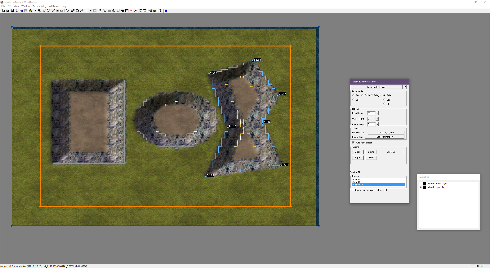

# WorldBuilder Toolkit

**Draw your map, let WorldBuilder build it.**

An unofficial, modified build of the C&C Generals: Zero Hour WorldBuilder, with a modern
interface on top. You draw shapes, rivers and roads; the real WorldBuilder engine underneath turns
them into terrain, textures and water. A local REST API lets scripts and AI agents drive the
editor too. Not made, endorsed or supported by Electronic Arts; you need your own installed copy
of the game.

## Download

Get the latest **WorldBuilder Toolkit** from the
[Releases page](https://github.com/LijpePietje/GeneralsGameCode/releases/latest): run the setup, or
unzip the zip into your game folder. The release notes have the install steps.

Use v0.2.1 or later. Earlier versions had a security hole in the local API (any web page open in
your browser could drive the editor while it ran); the v0.2.1 notes explain it.

## Where the source is

- **The editor** (`WorldBuilderZH_Toolkit.exe`) is built from this repository, branch
  [`feature/shapefill-tool`](https://github.com/LijpePietje/GeneralsGameCode/tree/feature/shapefill-tool).
  That is the source the GPL offer in the releases refers to.
- **The interface** is developed separately. This folder used to hold a copy of it from
  July 2026; that copy was outdated and has been removed.

The Terrain & Texture Painter tool is described in [USAGE_TerrainPainter.md](../USAGE_TerrainPainter.md).
